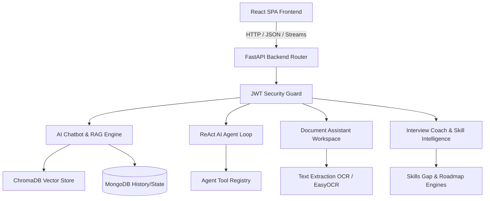
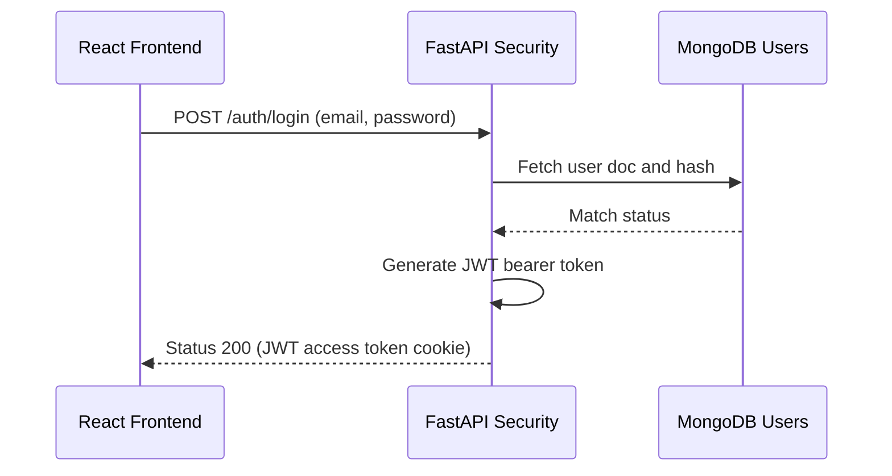
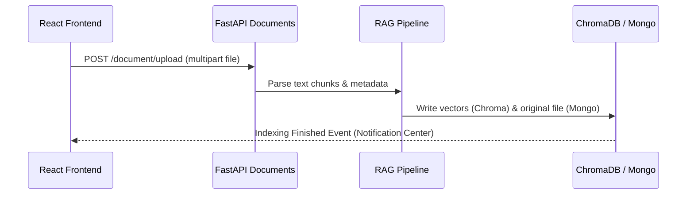
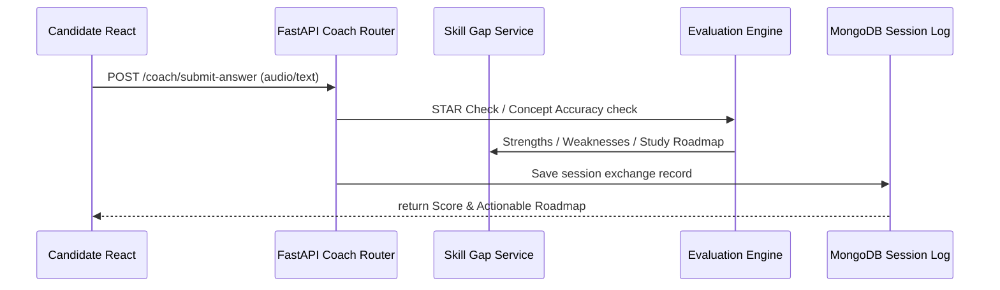

# AI Career Assistant - Production Telemetry & Orchestration Portal

A production-ready, full-stack Generative AI career intelligence and learning platform containing four enterprise-grade modules:
1. **AI Chatbot with RAG**: Semantic text search, Hybrid Vector/BM25 retrieval, query rewriting, reranking, source citations, and memory.
2. **AI Agent**: ReAct-based executor executing tools (Calculator, Web Search, File Reader, Python executing environment, CSV, Weather, Research) with plan-reflect-retry reasoning.
3. **AI Document Assistant**: OCR, PDF/Docx/Pptx/Xlsx converters, mind-map generation (via Mermaid), translation, comparison, flashcards, and quizzes.
4. **AI Interview Coach**: Technical coding sandbox, behavioral STAR scoring, ATS compatibility checker, voice synthesis transcription, and visual webcam feedback simulation.

Includes an **Admin Dashboard** tracking system health (MongoDB and FastAPI ping), security audit log events, dynamic feature flags, and token latency telemetry.

---

## 🏗️ System Architecture



---

## 🔄 Core Request Lifecycles

### 1. User Login & Token Verification


### 2. Document Indexing & RAG Retrieval


### 3. Interview Coach Evaluation Flow


---

## 🛠️ Technology Stack
- **Frontend**: React, TypeScript, Tailwind CSS, Vite, Mermaid UI, Prism syntax highlighters.
- **Backend**: FastAPI (Python 3.10+), LangChain, ChromaDB, Hugging Face Inference API, Motor (Async MongoDB).
- **Inference Models**:
  - Chat: `Qwen/Qwen2.5-7B-Instruct`
  - Embeddings: `BAAI/bge-small-en-v1.5`
  - Speech-to-Text: `Whisper`

---

## 🚀 Getting Started

### 1. Requirements
- Docker and Docker Compose installed.
- Hugging Face Access Token (`HUGGINGFACEHUB_API_TOKEN`).

### 2. Configuration
Create a `.env` file in the `backend/` directory:
```env
MONGODB_URI=mongodb://localhost:27017/ai_career_assistant
CHROMA_DB_PATH=./chroma_db
HUGGINGFACEHUB_API_TOKEN=your_hugging_face_token_here
JWT_SECRET=supersecretportfoliojwtkey123
ENVIRONMENT=development
```

### 3. Running with Docker Compose
Run the entire application ecosystem with:
```bash
docker-compose up --build
```
- Frontend: `http://localhost:5173`
- Backend API Docs: `http://localhost:8000/docs` (Swagger OpenAPI UI)
- MongoDB: `mongodb://localhost:27017`

### 4. Running Locally (without Docker)
**Backend Setup**:
```bash
cd backend
python -m venv venv
source venv/bin/activate  # Or venv\Scripts\activate on Windows
pip install -r requirements.txt
uvicorn app.main:app --reload
```

**Frontend Setup**:
```bash
cd frontend
npm install
npm run dev
```

---

## 🔒 Security & Performance
- **Dynamic Feature Flags**: Control chatbot streaming, agent execution loops, and OCR tasks directly from the Admin Telemetry Portal.
- **Auditing**: Every critical security action (logins, updates, uploads) registers structured event logs in MongoDB.
- **Health Checks**: Endpoint `/api/v1/admin/health` actively queries system dependencies and database connections.
