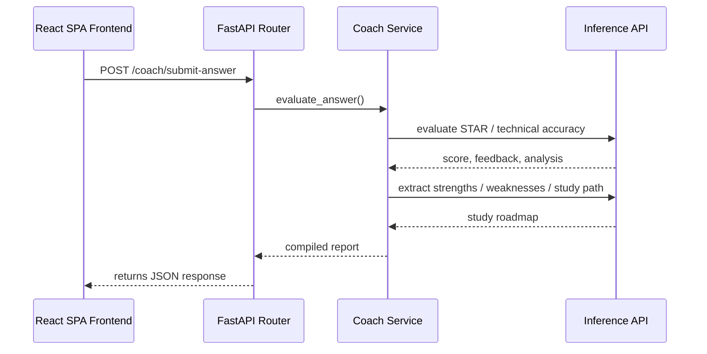

# System Architecture & Design Decisions

This document details the software design patterns, layout structure, and pipeline logic of the AI Career Assistant.

## Design Patterns

### 1. Clean Service Modularity
The codebase strictly separates data mapping (Repositories), operations workflow (Services), and controllers (API Routers).
- **RAG Pipeline**: Split into `ingestion_pipeline.py`, `retrieval_pipeline.py`, and `generation_pipeline.py`.
- **Skills Intelligence**: Decoupled into `skill_extractor.py`, `skill_gap_service.py`, `learning_path_service.py`, and `career_match_service.py`.
- **Interview Coach**: Separated into `question_generator.py`, `session_manager.py`, `evaluation_engine.py`, `feedback_engine.py`, `scoring_service.py`, and `improvement_planner.py`.

### 2. Stream-Based Telemetry & Observability
- Event streaming utilizes Server-Sent Events (SSE) to deliver progress updates (e.g. `decide`, `execute_tool`, `reflect`) to the user interface.
- Dynamic feature flags let administrators control active execution routes on the fly without restarting server nodes.

## Component Interactions

